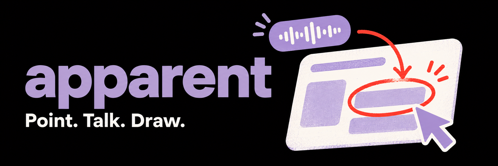

# Apparent

### Point. Talk. Draw. Let your agent take it from there.

That button. That weird layout. That bug that only happens when you do *this*.
Show your agent what you mean with a quick screen recording, your voice, and a few marks.

[Download Apparent](https://github.com/tryapparent/apparent/releases) · [Agent quickstart](https://app.tryapparent.com/agents/) · [Docs](#find-your-way) · [MIT](LICENSE)

## Show a visual bug to Codex or Claude Code

1. **Record your screen** — press `⌥⇧S` on macOS or `Alt+Shift+S` on Linux.
2. **Make your point** — talk, click around, hold `Shift` to draw, or `Shift`-click to drop a pin.
3. **Hand it off** — press the shortcut again, then review the unsent draft or paste from your clipboard.

Your agent gets annotated frames, a timed transcript, and an interaction timeline
in a local `.apparent` bundle. It can inspect more frames around the moment you describe.

If a menu closes before you can point to the item, record the lead-up. In the
[Rename-menu example](https://app.tryapparent.com/agents/#example), the frames show when it disappears.

## Get started

**[Download for macOS or Linux](https://github.com/tryapparent/apparent/releases)**,
launch Apparent, and grant permissions. Linux main builds are previews.
Ubuntu Desktop and Windows are unsupported.
[Ubuntu support via a .deb](https://github.com/tryapparent/apparent/issues/1774) is deferred.

Paste into your agent for setup.

```markdown
Install the Apparent desktop app from [Apparent releases](https://github.com/tryapparent/apparent/releases), then launch it.
```

[Record and point](https://app.tryapparent.com/guides/record-screen-for-coding-agent/) · [Import an MP4 or MOV](https://app.tryapparent.com/guides/send-existing-screen-recording/) · [Show the right control](https://app.tryapparent.com/guides/show-coding-agent-right-ui-element/)

## Agents

Install the optional reading skill for Codex, Claude Code, or OpenCode.

```sh
bunx skills add https://github.com/tryapparent/apparent/tree/main/agent/skills/apparent
```

The skill teaches `apparent inspect`, `zoom`, and `frames`.
[Install the CLI separately](capture/agent/docs/installation.md).
Headless Linux agents can fetch and read captures.

## Have your agent make a video

Apparent also helps your agent **show what it made**, reproduce a bug on video,
or explain how something works. Install the separate video-making skill:

```sh
bunx skills add https://github.com/tryapparent/apparent/tree/main/agent/skills/make-it-apparent
```

Then ask your agent:

```text
Make it apparent: record a short demo of the change you just made.
Show the interaction and its result, add narration and captions,
and give me a playable video.
```

The skill guides the agent through recording real interactions, creating
explanatory visuals when needed, and checking the complete video before handing
it back. Proposed behavior and conceptual examples are labeled so you can tell
them apart from working software.

Live desktop demos need the app running on the agent's machine, capture
permissions, and a safe screen to record. See the
[video-making skill](agent/skills/make-it-apparent/SKILL.md) and
[agent video workflow](capture/agent/docs/agent-video-workflow.md) for setup and
verification details.

## Find your way

| I want to… | Start here |
| --- | --- |
| Record, draw, change shortcuts, or set up permissions | [Recording guide](capture/desktop/docs/guides/recording.md) |
| Set up a Linux desktop | [Linux guide](capture/desktop/docs/linux/linux.md) |
| Install the CLI on my agent's machine | [Agent installation](capture/agent/docs/installation.md) |
| Inspect, zoom, copy, or reprocess a capture | [CLI and agent guide](capture/agent/docs/usage.md) |
| Have an agent create a demo, bug video, or explainer | [Video-making skill](agent/skills/make-it-apparent/SKILL.md) · [Video workflow](capture/agent/docs/agent-video-workflow.md) |
| Choose a transcriber, tune crops, or export video | [Processing guide](capture/engine/docs/guides/processing.md) |
| Fetch shared captures with Connect | [Connect setup](connect/docs/hosted-client.md) |
| Build and test Apparent | [Development reference](enablement/docs/development.md) · [macOS packaging](capture/desktop/docs/release.md) |
| Understand the bundle format | [Keyframes and text](capture/engine/docs/keyframes-and-text.md) |

**Connect is a candidate integration.** Uploads are off by default. Upload approval
and agent read approval are separate; website sign-in grants neither.
[Setup and current limits](connect/docs/hosted-client.md).

## Star history

[](https://www.star-history.com/#tryapparent/apparent&Date)

## License and credits

Apparent started as a fork of [Scrawl](https://github.com/kitlangton/scrawl), the screen recorder created by [Kit Langton](https://github.com/kitlangton). Thank you to Kit and the Scrawl contributors for the work Apparent builds on.

Apparent is [MIT licensed](LICENSE). See the
[third-party notices](capture/desktop/docs/guides/credits.md) for additional credits.
